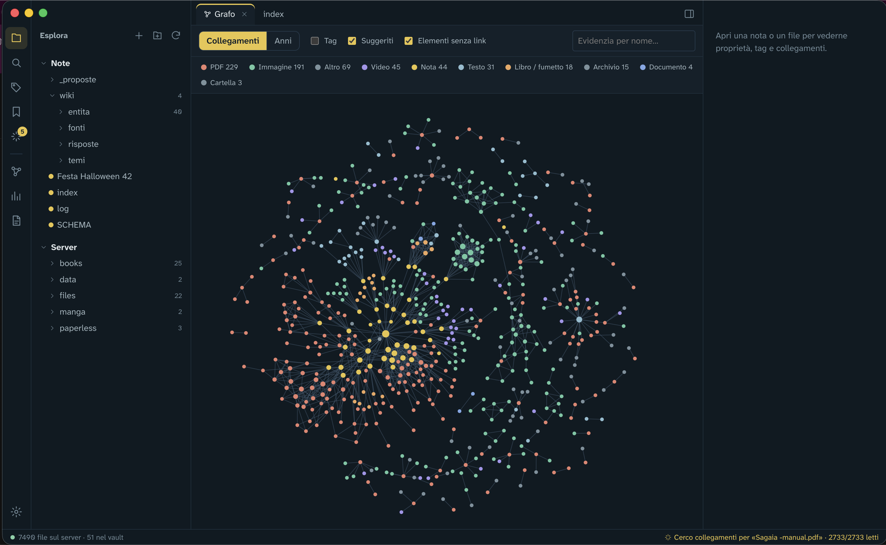
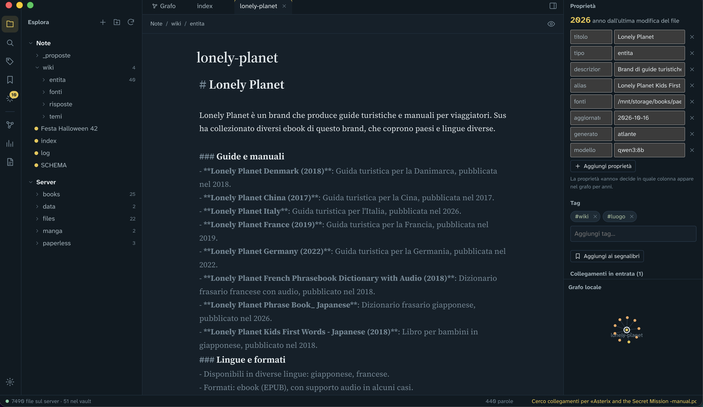

# Atlante

An Obsidian-style app for everything that lives on your home server.

I have a home server full of stuff: documents, ebooks, PDFs, old notes, photos scattered around folders. I wanted to browse all of it, write notes that link to any of those files, and see how everything connects. Obsidian is great, but it only knows about its own vault. Atlante treats the whole disk as the vault, without ever touching your files.



---

## How it's made

Atlante has two parts:

```text
 Mac                                         Server
┌──────────────────────────┐   Tailscale   ┌───────────────────────────────┐
│ Atlante.app (Electron)   │ ────────────▶ │ engine (FastAPI, Docker)      │
│  editor, graph, search   │    HTTPS +    │  indexes the disk (read-only) │
│                          │     token     │  SQLite + full-text search    │
│ AI worker ── Ollama      │               │  writes only to the vault     │
│ (local LLM, optional)    │               │                               │
└──────────────────────────┘               └───────────────────────────────┘
```

- **The engine** runs on the server. It indexes a folder of your choice in **read-only** mode and keeps a SQLite index with full-text search (PDFs included). The only place it writes to is the vault, the folder with your Markdown notes.
- **The app** runs on the Mac and talks to the engine over HTTPS. I reach the server through Tailscale, so nothing is exposed to the internet.
- **The AI part is optional** and runs entirely on the Mac with Ollama: no cloud APIs, your files never leave your network.

---

## Features

- A tree with every file on the server plus your notes
- Markdown notes with `[[links]]` to other notes **and to any file on the server** (`[[/books/some-book.epub]]`)
- `![[embeds]]` for images, PDFs, videos and other notes, plus `#tags`
- Backlinks, outgoing links and unlinked mentions, with a button to turn a mention into a link
- Tags and properties on any server file, stored separately: the original files are never modified
- Search in names and content (PDFs included), with filters for type, year, tag and property
- Two graph views:
  - **Links** (*Collegamenti*): the classic Obsidian-style graph
  - **Years** (*Anni*): one column per year, one lane per file type, click a year to pull in its files
- Local graph in the side panel, command palette (⌘P), quick open (⌘O), bookmarks, previews

### Agenda: events and to-dos

Events are plain notes with `tipo: evento` and a `data:` in the frontmatter. To-dos are ordinary Markdown checkboxes in any note, with an optional due date in the [Obsidian Tasks](https://publish.obsidian.md/tasks/) style:

```markdown
- [ ] Book the room 📅 2026-10-17
- [x] Order pizza
```

- **New event** (⌘P or the button in the Agenda) creates `eventi/<date> <name>.md` from a template in `_modelli/evento.md`. Due dates in the template can be relative to the event (`📅 -7` = a week before) and become real dates when the event is created. The template is a normal note: edit it and the next events will use it.
- **Agenda** (calendar icon) shows the month with your events, their progress (`3/15` to-dos done) and how many to-dos are due each day. On the side, a *To do* list grouped into overdue, today, next 7 days and later.
- Ticking a to-do in the Agenda writes `[x]` into the note. To-dos in an event note without a date count as due on the event day.
- **Quick to-dos** without an event (the *Todo* button, double click on a day, or ⌘P → *Nuova todo*) go to `Da fare.md` in the vault, each with its own date.

### Working offline

The Mac app keeps a copy of the vault (notes, events, to-dos and the files in the vault) in `~/Library/Application Support/Atlante/vault` and syncs it with the server every minute. When the server can't be reached (no internet, Tailscale off), Atlante switches to that copy by itself: you can read and edit notes, use the Agenda, tick and add to-dos and create events. The status bar turns yellow and says *Offline*.

When the server is back, the changes made offline are synced first, then the app goes back online.

- If the same note was changed on both sides, the server version stays and yours is saved next to it as `name (conflitto Mac YYYY-MM-DD HHMM).md`. Nothing gets lost.
- Offline you can still rename, move and delete notes (deleted ones go to the trash on the server once you're back). The server files, the graph and the AI suggestions need the server.
- If a lot of files suddenly disappear from one side (the server's disk got unplugged, say), the sync deletes nothing and tells you.

### Where a file's year comes from

The Years graph needs to know when each file is from. Atlante tries, in order:

1. the `year` (or `anno`) property, if you set it (in the Properties panel or in the note's frontmatter)
2. the file's own metadata: PDF creation date, EXIF date of photos, `date:` in notes
3. a date in the file or folder name (`2015-06-12.pdf`, `photos/2015/06/…`)
4. otherwise, the last modified date

Files downloaded from the internet often have the download date as their modified date. For those, set the year yourself.

### Suggested links and the compiled wiki (optional, needs Ollama)

With Ollama running on the Mac, the app analyses your files in the background:

1. **Profile**: extracts people, places, organizations and projects from each file, plus a short summary
2. **Match**: finds files that share entities and asks the model whether the connection is real
3. **Compile**: writes a wiki page for every entity that appears in at least 3 files

Suggested links show up as dashed edges in the graph and in a Suggestions panel. **Nothing becomes a real link until you approve it.**

The wiki follows Andrej Karpathy's "LLM Wiki" idea: instead of a database-backed knowledge graph, the LLM maintains a folder of plain Markdown pages in `vault/wiki/`. Each page has a summary, key facts, things to double-check, links to related pages and the list of sources. Pages get updated as new files arrive, not rewritten from scratch. A few rules keep it sane:

- `index.md` and `log.md` are written by the engine, not by the LLM (an 8B model is great at summarizing, less great at keeping a long index consistent)
- generated pages have `generato: atlante` in their frontmatter. Add `bloccata: true` and the page becomes yours: Atlante won't touch it again
- the wiki is never analysed as a source, so the LLM doesn't end up quoting itself



---

## Setup

Atlante works in two ways, and you pick one in the app's settings:

- **My server**: the engine runs on a home server (Docker) and the Mac app reaches it, for example through Tailscale. This is how I use it.
- **This Mac**: no server needed. You choose a folder or an external disk on your Mac and the app runs the same engine locally. Jump to [Without a server](#without-a-server).

### Requirements

- For *My server*: a Linux server with Docker
- For *This Mac*: Python 3.10 or newer on the Mac (`brew install python`, or the installer from python.org)
- A Mac with Apple Silicon for the app (the build targets `arm64`)
- Node.js 20+ to build the app
- Optional: [Tailscale](https://tailscale.com) on both, to reach the server from anywhere
- Optional: [Ollama](https://ollama.com) on the Mac, for suggested links and the wiki

### 1. Start the engine on the server

```bash
git clone https://github.com/SusannaKay/MacOs_atlante.git
cd MacOs_atlante/server
cp .env.example .env
```

Edit `.env`:

- `ATLANTE_TOKEN`: the password the app uses. Generate one with `openssl rand -hex 32`
- `STORAGE_PATH`: the folder to index. It's mounted read-only
- `VAULT_PATH`: the folder for your notes. It's the only writable one, and it can live inside `STORAGE_PATH`
- `PUID` / `PGID`: the user the container runs as (`id -u` and `id -g`). It needs read access to `STORAGE_PATH` and write access to `VAULT_PATH`

Then check `config.yaml` for folders to skip (backups, torrents in progress, other apps' databases), and start it:

```bash
docker compose up -d --build
docker compose logs -f
```

The first scan of a big disk takes a while. You'll see a line per scan in the logs.

### 2. Make it reachable from the Mac

The engine only listens on `127.0.0.1:8102` on purpose. With Tailscale, expose it to your tailnet only:

```bash
sudo tailscale serve --bg --https=8102 http://127.0.0.1:8102
```

The address for the app becomes `https://<server-name>.<tailnet>.ts.net:8102`.

Any reverse proxy with HTTPS works too. Just don't open the port to the internet: the token is the only thing between your files and the outside world.

### 3. Build the Mac app

```bash
cd MacOs_atlante/app
npm install
npm run dist
```

The app ends up in `app/release/mac-arm64/Atlante.app`. Drag it into Applications.

It's not signed, so the first time macOS will refuse to open it. Right click → *Open*, or run `xattr -dr com.apple.quarantine /Applications/Atlante.app`.

For development, `npm start` builds the interface and opens the app directly.

### 4. Connect

On first launch the app asks for the engine address and the token. The token is stored in the macOS Keychain.

### Without a server

1. Build the app as in step 3.
2. On first launch pick **This Mac**, then choose the folder or disk to organize and a folder for your notes (by default `~/Documents/Atlante`).
3. The first time the app prepares the engine by itself: it creates a private Python environment in `~/Library/Application Support/Atlante/engine` and installs what it needs. It takes a few minutes and needs internet; after that it starts in a second.

The folder you organize stays read-only, exactly like on the server. The engine listens only on `127.0.0.1` and stops when you quit the app. To read the text inside PDFs, install poppler too: `brew install poppler`. Without it everything works, PDFs are just found by name only.

If something goes wrong, the engine's log is in `~/Library/Application Support/Atlante/engine/engine.log`.

### 5. Optional: turn on the AI

```bash
brew install ollama
ollama pull qwen3:8b
```

Open Ollama, then in Atlante go to *Settings → Collegamenti automatici con Ollama*, pick the model and turn the analysis on. It runs in the background and pauses by itself if Ollama is closed.

I use `qwen3:8b`: it fits comfortably on a 16 GB Mac and is good enough at extracting entities. Bigger models give better suggestions and slower analysis.

---

## Project structure

```text
atlante/
├── server/                  the engine
│   ├── app/
│   │   ├── main.py          API, auth, notes, files
│   │   ├── indexer.py       disk scan, years, PDF text, thumbnails
│   │   ├── db.py            SQLite schema + FTS5
│   │   ├── notes.py         vault: links, tags, frontmatter
│   │   ├── ai.py            queue and storage for the AI analysis
│   │   ├── wiki.py          compiled wiki pages, index.md, log.md
│   │   ├── agenda.py        events, to-dos, event template, sync manifest
│   │   └── config.py
│   ├── config.yaml          folders to skip, scan interval
│   ├── docker-compose.yml
│   └── .env.example
└── app/                     the Mac app
    ├── main.js              Electron main process, settings, Keychain
    ├── ai-worker.js         talks to Ollama, runs profile/match/compile
    ├── vault/               offline copy of the vault: two-way sync and a local engine
    ├── engine.js            "This Mac" mode: prepares and runs the server engine on the Mac
    ├── preload.js
    └── src/                 interface: editor (CodeMirror), graph (d3-force), agenda, panels
```

---

## Things to know

- **The interface is in Italian.** It started as an app for myself. Translations are welcome.
- **macOS only** for now. The engine runs anywhere Docker does.
- The engine never writes outside the vault: the storage folder is mounted read-only, so this is enforced by Docker, not just by the code.
- Tags and properties on server files live in the engine's database (`server/data`). Back it up along with the vault.

---

## License

[MIT](LICENSE)
